# FTMC BSA–PEF Molecular Dynamics Project

## Overview

This repository contains the computational work performed during my internship at the Center for Physical Sciences and Technology (FTMC), Vilnius.

The project investigates how external electric fields may influence the structure and conformational dynamics of bovine serum albumin (BSA). A baseline molecular-dynamics (MD) control system is established first. Electric-field simulations will subsequently be compared with this control and interpreted alongside relevant experimental observations.

The current research stage focuses on the microsecond PEF regime. The nanosecond PEF regime will be investigated subsequently so that possible differences in BSA molecular response can be examined using a consistent computational framework.

## Internship

- Student: Ahmed Yomi Isiaka
- Programme: MSc Systems Biology, Vilnius University
- Host: Center for Physical Sciences and Technology (FTMC)
- Supervisor: Dr. Arūnas Stirkė
- Internship period: 16 September 2026 – 16 November 2026

## Research question

How does pulsed electric-field exposure affect the structure and conformational dynamics of bovine serum albumin, and can molecular-dynamics simulations help interpret relevant experimental observations?

The project initially investigates experimental microsecond PEF conditions and will later examine nanosecond PEF conditions to determine whether the two regimes are associated with distinguishable molecular responses in BSA.

## Project objectives

1. Review published evidence on electric-field effects on proteins.
2. Characterize BSA sequence and structural features.
3. Select and validate a suitable experimental BSA structure.
4. Prepare a reproducible all-atom BSA simulation system.
5. Establish a baseline control simulation without an electric field.
6. Translate relevant experimental PEF conditions into scientifically defensible computational questions.
7. Analyse RMSD, RMSF, radius of gyration, SASA, hydrogen bonding, secondary structure, dipole response and other relevant molecular properties.
8. Investigate selected electric-field conditions after validation of the control workflow.
9. Investigate the microsecond PEF regime first and the nanosecond PEF regime subsequently.
10. Compare computational trends with relevant experimental observations without assuming direct numerical equivalence between experimental PEF exposure and atomistic MD.

## Protein and structure

- Protein: Bovine serum albumin (BSA)
- Gene: ALB
- Organism: Bos taurus
- UniProt accession: P02769
- Canonical precursor length: 607 amino acids
- Mature chain: UniProt residues 25–607
- Mature-chain length: 583 amino acids
- Selected structure: PDB 4F5S, Chain A
- Experimental method: X-ray diffraction
- Resolution: 2.47 Å
- Preferred biological assembly: monomer

Chain B, crystallographic waters and the crystallization-associated PGE molecule were excluded from the baseline working structure.

## Sequence validation and canonical restoration

The mature BSA sequence extracted from UniProt P02769 was compared with PDB 4F5S Chain A.

The original structure contained one documented sequence difference:

- PDB mature-chain residue 190: THR
- Corresponding UniProt canonical residue 214: ALA

A canonical working structure was generated by restoring THR190 to ALA190 while preserving the original downloaded structure separately.

Final validation:

- UniProt mature sequence: 583 residues
- Processed 4F5S Chain A: 583 residues
- Final sequence identity: 100.00%

## Disulfide validation

The BSA monomer contains 35 cysteine residues.

Seventeen disulfide bonds were verified in the working structure. Cys34 remains the free cysteine in mature-chain PDB numbering.

The topology generated for MD preparation contained the expected 34 CYX residues corresponding to these 17 disulfide bonds.

## Molecular-dynamics software and model

Current baseline setup:

- GROMACS: 2023.3
- Protein force field: AMBER99SB-ILDN
- Water model: TIP3P
- Periodic box: dodecahedral
- Protein-to-box distance: 1.0 nm
- Nominal NaCl concentration: 0.15 M

AMBER99SB-ILDN and TIP3P are recorded as the models selected for this project and are not presented as universally optimal models.

## System preparation

Topology generation produced:

- Protein residues: 583
- Protein atoms: 9,216
- Approximate protein mass: 66,383 amu
- Initial protein charge: -16 e

After solvation:

- Initial water molecules: 29,950
- Approximate total atoms: 99,066

After ion placement:

- Na+: 109
- Cl-: 93
- Final water molecules: 29,748
- Final system charge: 0

The 0.15 M NaCl condition is used as a baseline simulation condition. It is not assumed to reproduce the ionic composition of an experimental PEF system unless established separately.

## Energy minimization

Steepest-descent energy minimization was performed with a maximum of 50,000 steps and an Fmax convergence criterion of 1000 kJ mol^-1 nm^-1.

The system converged after 1,206 steps.

Final results:

- Potential energy: -1.5524191e+06 kJ/mol
- Maximum force: 9.9985583e+02 kJ mol^-1 nm^-1
- Force norm: 1.6501566e+01 kJ mol^-1 nm^-1

Status: **Completed**

## NVT equilibration

A 100 ps restrained NVT equilibration was performed at 300 K using the V-rescale thermostat.

Results:

- Average temperature: 299.827 K
- RMSD: 2.927 K
- Total drift: 1.210 K

Status: **Completed**

## NPT equilibration

A 100 ps restrained NPT equilibration was subsequently performed.

Main conditions:

- Temperature: 300 K
- Target pressure: 1 bar
- Duration: 100 ps
- Thermostat: V-rescale
- Barostat: C-rescale
- Pressure coupling: isotropic
- tau_p: 5.0 ps
- Compressibility: 4.5e-5 bar^-1

Temperature over 0–100 ps:

- Average: 300.024 K
- RMSD: 1.013 K

Density over 0–100 ps:

- Average: 1011.58 kg/m^3

Density over the final 50 ps:

- Average: 1012.71 kg/m^3
- Error estimate: 0.43 kg/m^3
- RMSD: 1.41 kg/m^3

Pressure over the final 50 ps:

- Average: 3.60 bar
- Error estimate: 6.1 bar
- RMSD: 99.96 bar

The reduced density drift during the final half of the trajectory and the pressure average approaching the target within its statistical uncertainty were used to accept this NPT stage as the initial equilibrated checkpoint.

Status: **Completed**

## Microsecond PEF experimental anchor

The current computational-planning stage focuses on the microsecond PEF experiment reported by Taha et al. (2022).

Relevant experimental conditions include:

- Protein system: BSA/starch
- Pulse duration: 50 μs
- Number of pulses: 10
- Electric-field strengths: 3.5, 4.5, 5.7 and 8.1 kV/cm

Converted to V/nm:

- 3.5 kV/cm = 0.00035 V/nm
- 4.5 kV/cm = 0.00045 V/nm
- 5.7 kV/cm = 0.00057 V/nm
- 8.1 kV/cm = 0.00081 V/nm

The cumulative nominal field-on time for 10 × 50 μs pulses is 500 μs.

These experimental parameters provide the biological and physical reference for the current stage of the project. They are not automatically treated as directly transferable atomistic-MD parameters.

## Experimental–computational interpretation

Experimental PEF exposure and electric fields applied in atomistic MD can operate on substantially different timescales and field-strength regimes.

The experimental pulse duration and the MD trajectory duration are therefore treated as different quantities.

For example:

- 50 μs experimental pulse = 50,000 ns
- 30 ns MD trajectory = 0.03 μs

Therefore, an MD trajectory lasting tens of nanoseconds must not be described as a direct simulation of a 50 μs experimental pulse.

The current MD work is instead described as an investigation motivated by the experimental microsecond-PEF study.

Direct numerical or temporal equivalence between experimental PEF conditions and MD electric-field parameters will not be assumed unless an appropriate physical justification is established.

The initial simulation system contains BSA without starch. It therefore investigates possible molecular responses of BSA rather than directly reproducing the complete experimental BSA/starch system.

## Experiment-to-MD analysis framework

Experimental measurements and MD observables will be related cautiously.

- DLS particle size → radius of gyration (Rg) can provide information about molecular compactness, but Rg is not equivalent to hydrodynamic particle size.
- Surface hydrophobicity → hydrophobic SASA can provide an indirect measure of changes in hydrophobic exposure.
- Intrinsic fluorescence → local aromatic-residue environments, contacts and solvent exposure may provide indirect structural interpretation.
- Grafting/glycation → not directly represented in the initial BSA-only classical MD system.
- Protein solubility → no direct single-protein MD equivalent.
- Emulsifying properties and stability → no direct single-BSA MD equivalent.

Additional MD analyses will include:

- RMSD
- RMSF
- Radius of gyration (Rg)
- Solvent-accessible surface area (SASA)
- Intramolecular hydrogen bonds
- Secondary structure
- Protein dipole response
- Field-related orientational behaviour where appropriate

No individual metric will by itself be treated as proof of protein unfolding or destabilization. Structural interpretation will be based on combined evidence relative to the no-field control.

## Pilot simulation strategy

The initial electric-field pilot has been completed using GROMACS 2023.3.

- Electric field: 0.00057 V/nm (5.7 kV/cm), constant along X-axis.
- Original pilot: 4.02 ns, 403 frames.
- Recovery: 100 ps re-equilibration and 0.98 ns production, 99 frames.
- Recovery used regenerated velocities after a checkpoint problem.
- These are separate production segments, not an uninterrupted trajectory.
- A matched no-electric-field control is the next stage.
- The proposed 0.0012 V/nm condition has not yet been simulated.

## Current project status

### Completed

- BSA structure preparation, sequence validation and topology generation.
- Energy minimization, NVT and NPT equilibration.
- Original 4.02 ns electric-field pilot.
- Separate 0.98 ns recovery production.
- RMSD, Rg, RMSF, hydrogen-bond, SASA and DSSP analyses.
- Fourteen structural-analysis figures.

### Current focus

- Validate the SASA atomic-radii assignments.
- Organize scripts, figures and numerical results.
- Prepare the matched no-electric-field control.

### Future work

- Compare electric-field and no-field trajectories.
- Longer simulations and independent replicates.
- Protein orientation and dipole-response analysis.
- Pulsed-field studies where feasible.

## Computing considerations

The current local GROMACS installation is CPU-only.

For the approximately 100,000-atom solvated BSA system, previous equilibration performance was approximately:

- NVT: 1.143 ns/day
- NPT: 1.077 ns/day

Longer production trajectories and replicate simulations would therefore benefit substantially from GPU/server resources.

Protocol development, documentation, short validation tests and analysis preparation can continue locally while additional computing resources are being investigated.

## Repository structure

The repository contains the following main directories:

- `docs/`: research notes and simulation documentation.
- `data/`: BSA input structures and processed data.
- `scripts/`: structure-preparation scripts.
- `simulations/control/`: no-field setup and test files.
- `simulations/microsecond_pef/pilot/`: original field simulation.
- `simulations/microsecond_pef/recovery_20261022/`: recovery segment.
- `analysis/electric_field/pilot_4ns/`: original pilot analysis.
- `analysis/electric_field/scripts/`: recovery plotting scripts.
- `analysis/electric_field/results/`: recovery numerical results.
- `figures/electric_field/`: analysis figures.

Large simulation trajectories and checkpoints are excluded from Git.

---

## BSA Molecular Dynamics Under a Constant Electric Field

### Research objective

This pilot study investigates the conformational behavior of bovine serum
albumin (BSA) during molecular-dynamics simulation under an applied electric
field.

Structural properties are assessed using backbone RMSD, radius of gyration,
residue RMSF, intramolecular hydrogen bonds, solvent-accessible surface area,
and DSSP secondary-structure assignments.

The ultimate objective is to compare electric-field and matched no-field
simulations to investigate whether the applied field is associated with
changes in BSA structure and dynamics.

### Simulation conditions

| Parameter | Setting |
|---|---|
| Molecular-dynamics software | GROMACS 2023.3 |
| Protein | Bovine serum albumin (BSA), 583 residues |
| Force field | AMBER99SB-ILDN |
| Water model | TIP3P |
| Temperature | 300 K |
| Target pressure | 1 bar |
| Electric field | 0.00057 V/nm (5.7 kV/cm) |
| Field direction | X-axis |
| Field type | Constant, not pulsed |
| Original pilot trajectory | 4.02 ns, 403 frames |
| Recovery re-equilibration | 100 ps |
| Recovery production | 0.98 ns, 99 frames |

### Important simulation history

The original electric-field pilot produced a trajectory covering 0–4.02 ns.

A checkpoint compatibility problem prevented direct continuation. The final
coordinates from the original pilot were used to prepare a new simulation
with regenerated velocities and a 100 ps re-equilibration stage.

A separate 980 ps recovery production segment was subsequently completed,
covering simulation times 4.12–5.10 ns.

**The original pilot and recovery production are not one uninterrupted
trajectory.** Their results are reported separately.

### Structural analysis results

The values below are descriptive statistics from the respective trajectories.

| Measurement | Original pilot (4.02 ns) | Recovery (0.98 ns) |
|---|---:|---:|
| Frames analyzed | 403 | 99 |
| Mean backbone RMSD (nm) | 0.2078 | 0.1482 |
| Mean radius of gyration (nm) | 2.7472 | 2.7486 |
| Mean residue RMSF (nm) | 0.1351 | 0.0872 |
| Mean intramolecular hydrogen bonds | 483.682 | 485.85 |
| Mean SASA, 240 dots (nm²) | 295.553 | 294.334 |
| Alpha-helix assignments (%) | 65.36 | 65.12 |

RMSD values use segment-specific reference structures. RMSF depends on the
sampling interval and simulation duration. These quantities should not be
interpreted as direct evidence that one segment is more stable than the other.

The original pilot exhibited elevated residue RMSF around residues 559–568.
Both segments showed predominantly alpha-helical DSSP assignments.

The results do not establish that the electric field caused stabilization,
destabilization, or unfolding. A matched no-field control and longer,
preferably replicated simulations are required.

### SASA calculation limitation

SASA was calculated using a solvent probe radius of 0.14 nm and 240 sampling
dots per sphere.

GROMACS warned that atomic van der Waals radii and masses were estimated
from residue and atom names. The absolute SASA values therefore remain
provisional until the atomic-radius assignments are validated.

### Original pilot figures (0–4.02 ns)

#### Backbone RMSD

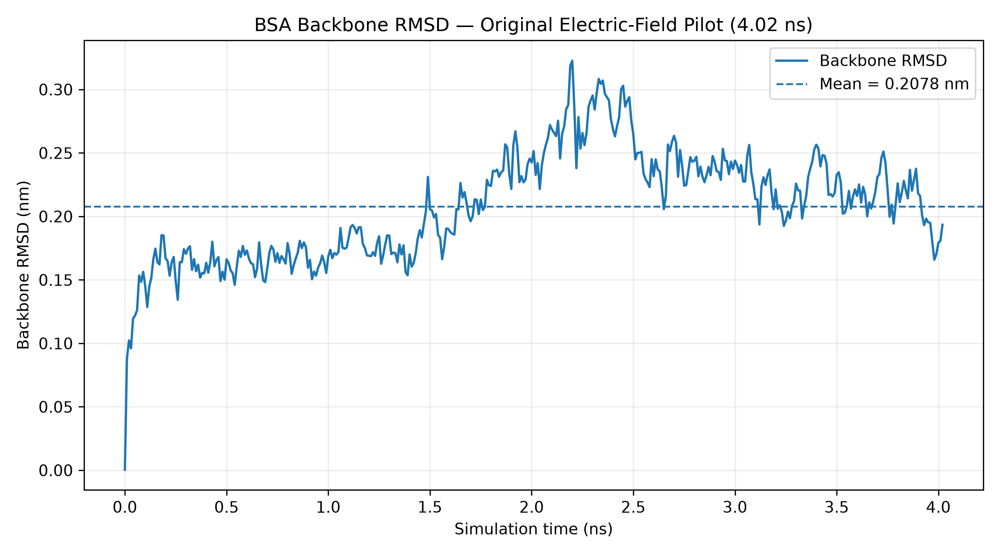

#### Radius of gyration

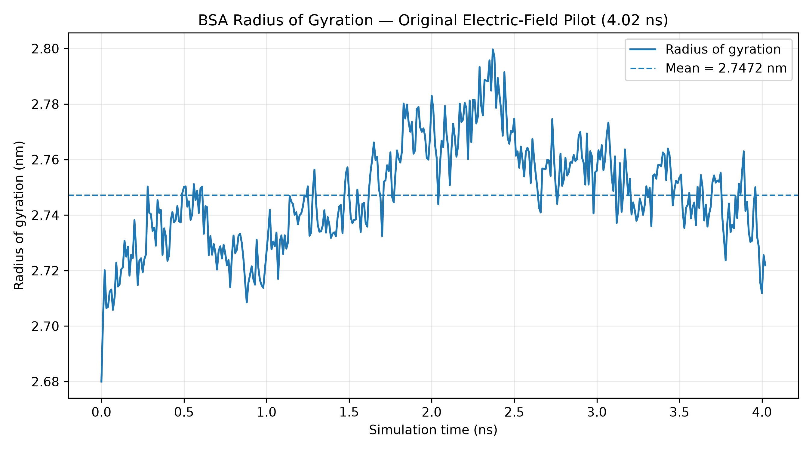

#### Residue RMSF

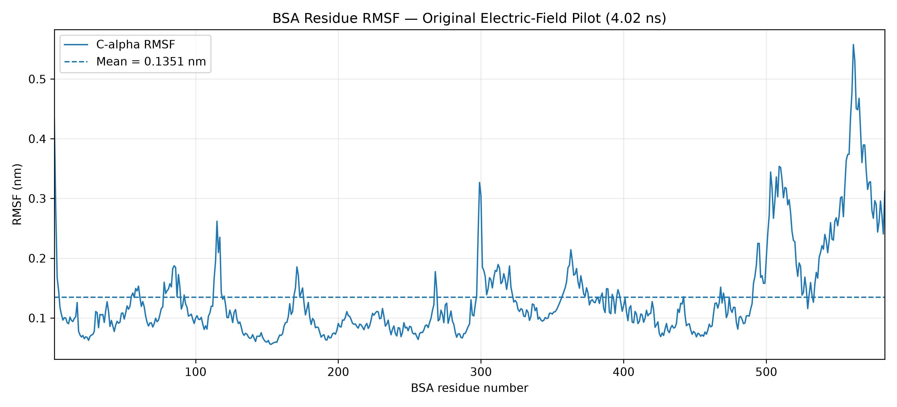

#### Intramolecular hydrogen bonds

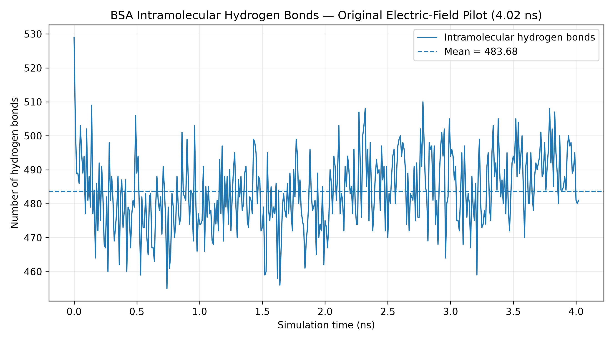

#### Solvent-accessible surface area

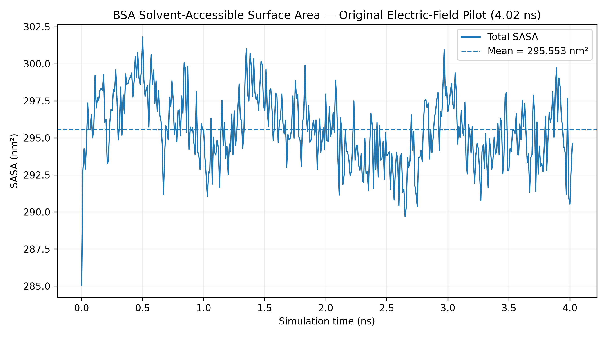

#### Secondary-structure composition

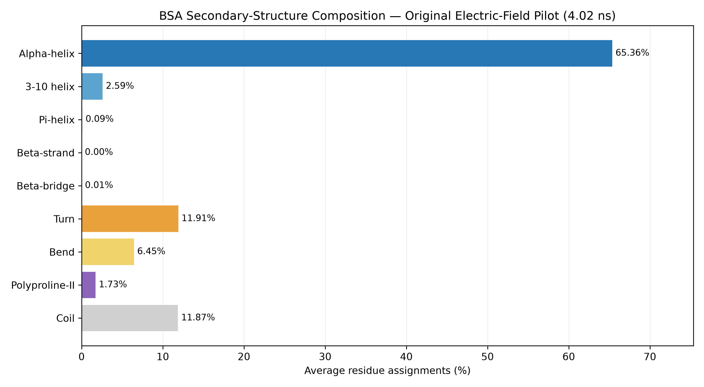

#### Secondary-structure evolution

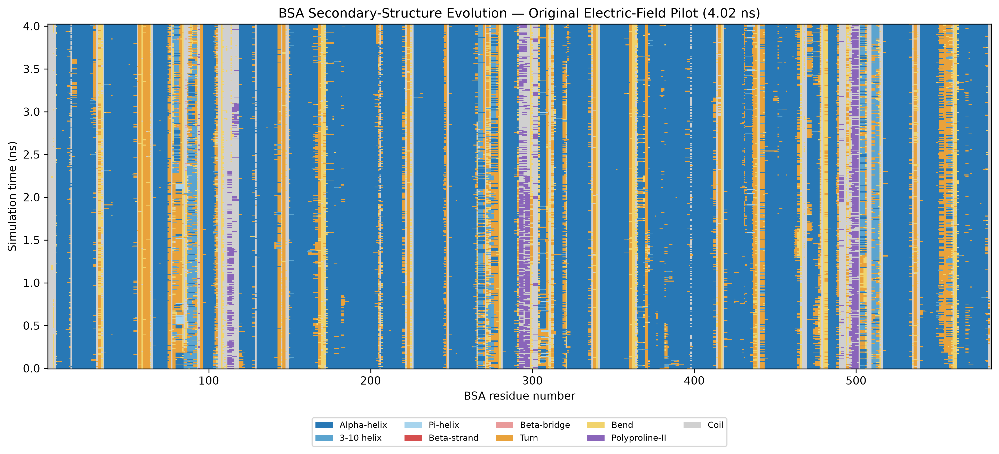

### Recovery production figures (4.12–5.10 ns)

#### Backbone RMSD

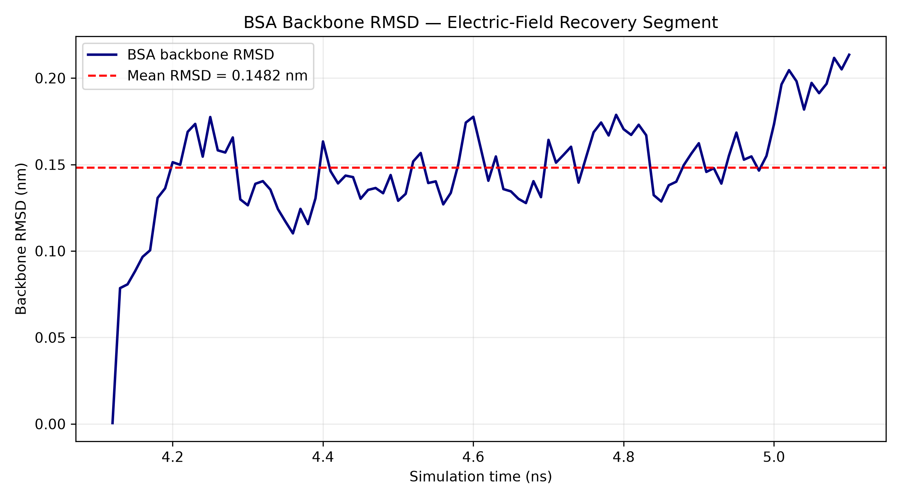

#### Radius of gyration

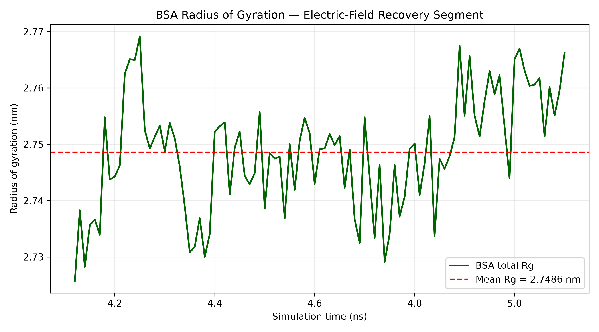

#### Residue RMSF

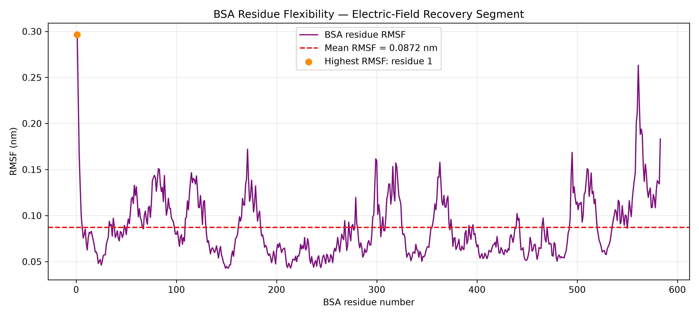

#### Intramolecular hydrogen bonds

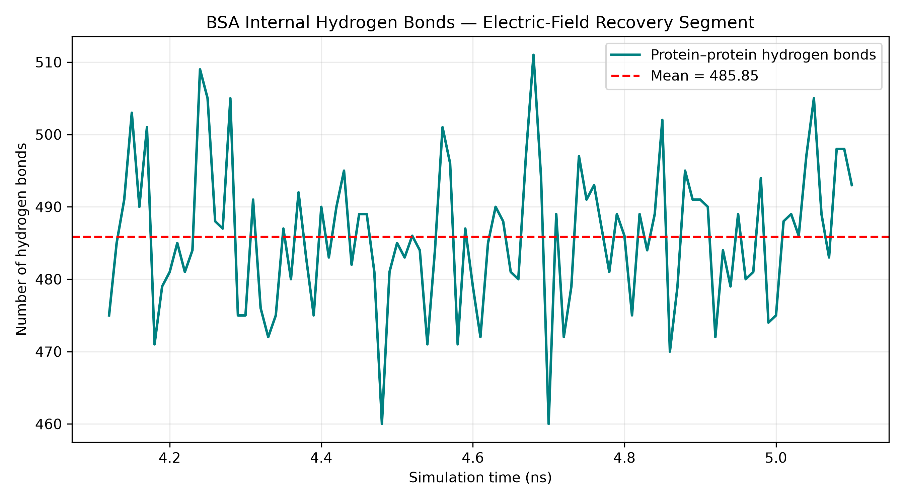

#### Solvent-accessible surface area

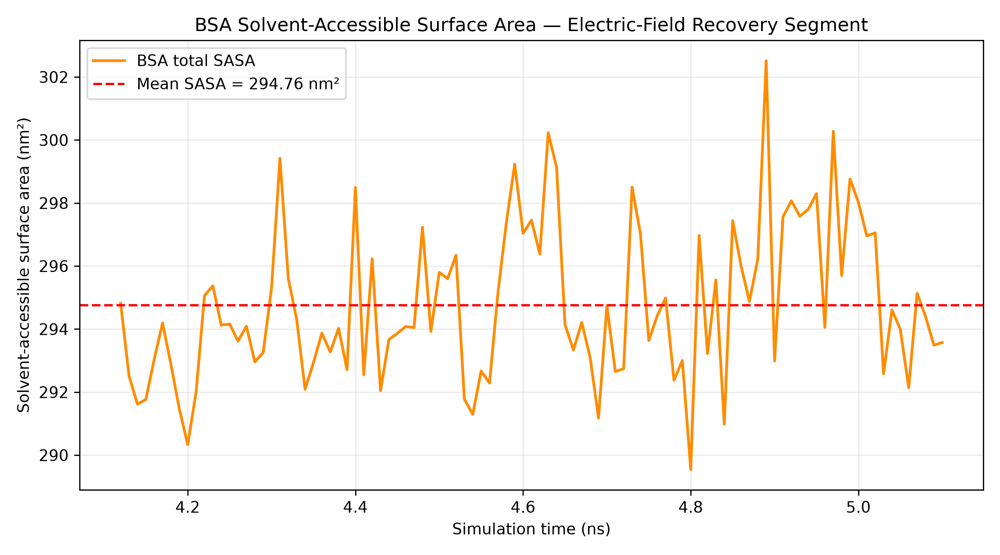

**Note:** The recovery SASA figure was originally generated using 24 sampling
dots per sphere. A separate 240-dot calculation is available in the results
directory and is used for the comparison table above.

#### Secondary-structure composition

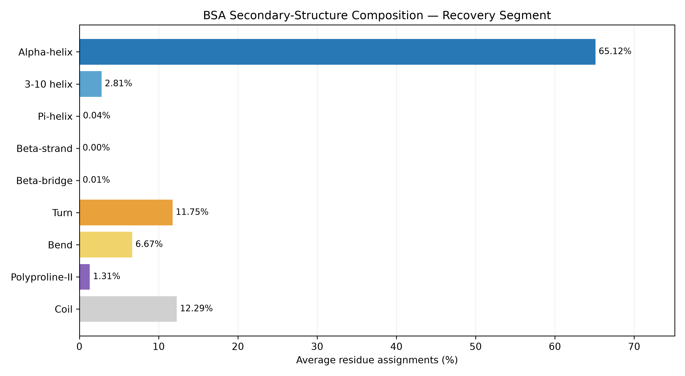

#### Secondary-structure evolution

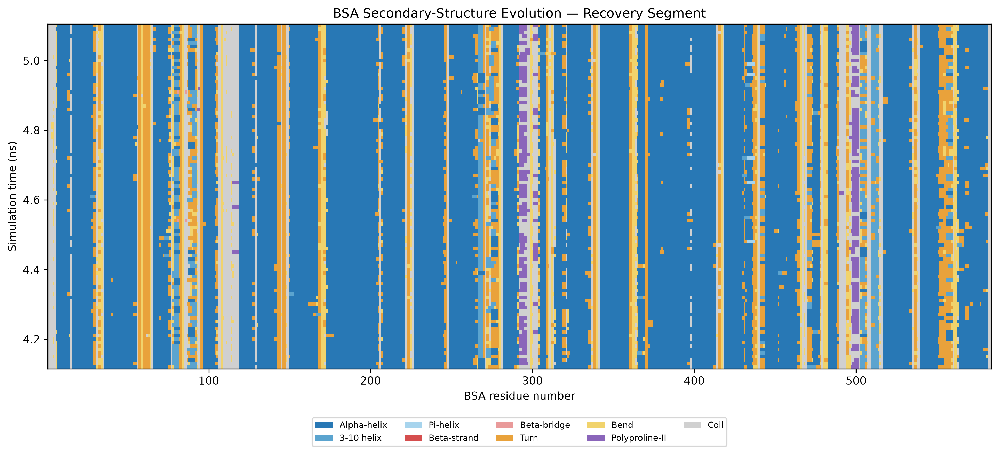

### Analysis and reproducibility

Original pilot numerical results and plotting scripts:

`analysis/electric_field/pilot_4ns/`

Recovery plotting scripts:

`analysis/electric_field/scripts/`

Recovery numerical results:

`analysis/electric_field/results/`

Figures:

`figures/electric_field/`

Original GROMACS simulation files are retained locally under:

`simulations/microsecond_pef/`

Large trajectories, checkpoints, and binary simulation files are excluded
from GitHub through `.gitignore`.

### Next steps

1. Validate SASA atomic-radius assignments.
2. Complete documentation and reproducibility checks.
3. Inspect and prepare the matched no-electric-field control.
4. Analyze no-field trajectories using equivalent methods.
5. Compare electric-field and no-field results.
6. Extend sampling and consider independent simulation replicates.
7. Investigate pulsed electric-field protocols in future work.
